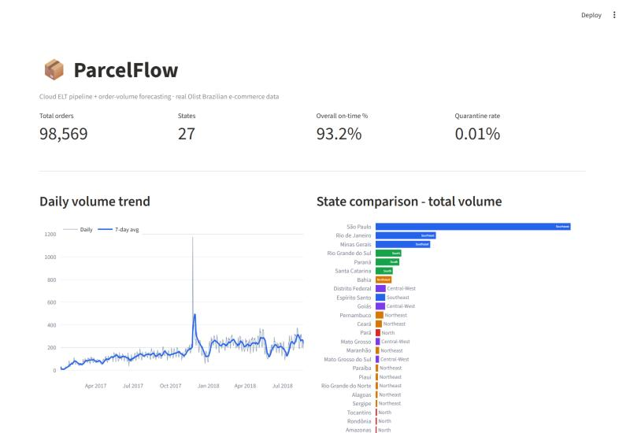
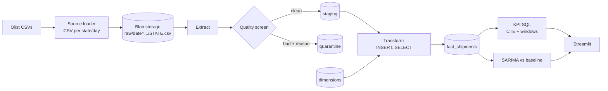

# 📦 ParcelFlow

**A cloud ELT pipeline and order-volume forecasting dashboard, built on real
e-commerce data.** Real daily orders are extracted to blob storage per
destination state, quality-screened, loaded into a star-schema warehouse, and
forecasted 14 days ahead with SARIMA — all runnable on a laptop with **one
command and zero cloud setup**.

> Data is the **real** [Olist Brazilian e-commerce dataset](https://www.kaggle.com/datasets/olistbr/brazilian-ecommerce)
> (~100k orders, 2017–2018). Nothing is synthetic or fabricated.


## Demo



*Streamlit dashboard over the SQLite star schema: headline KPIs, the daily
order-volume trend with a 7-day moving average, and total volume by state and
Brazilian region.*

---

## What it does

- **Reads** the real Olist orders, joins them to the destination **customer
  state** and to per-order item/freight aggregates, and partitions them by day.
- **Extracts** files to blob storage (local filesystem, or Azure Blob / Azurite),
  one CSV per state per day under `raw/date=.../STATE.csv`.
- **Screens** data quality: inconsistent rows (e.g. an order marked *delivered*
  with no delivery date) are quarantined with a reason, not dropped.
- **Loads** a **star-schema** warehouse (`fact_shipments` + `dim_hub` (state) /
  `dim_date` / `dim_order_status`).
- **Computes KPIs** in portable SQL using CTEs and window functions.
- **Forecasts** 14-day order volume per state with **SARIMA**, benchmarked
  against a seasonal-naive baseline and scored by **MAPE** on a holdout.
- **Visualises** everything in a Streamlit dashboard.

## Dataset

[Olist Brazilian E-Commerce Public Dataset](https://www.kaggle.com/datasets/olistbr/brazilian-ecommerce)
— Kaggle slug `olistbr/brazilian-ecommerce`, license **CC BY-NC-SA 4.0**.
~100k real orders placed on Olist between 2016 and 2018. ParcelFlow reads three
of its tables (`olist_orders`, `olist_customers`, `olist_order_items`) and uses
the **dense, complete window 2017-01-05 → 2018-08-22** (order collection tapers
off after that). Download it (Kaggle account required) with:

```bash
pip install kaggle   # then place your kaggle.json / token per Kaggle's docs
kaggle datasets download -d olistbr/brazilian-ecommerce -p data/raw/olist --unzip
```

The CSVs (~120 MB) are **git-ignored** — download them locally; they are never
committed.

### How the real data maps onto the model

| Model element | Real Olist source |
|---------------|-------------------|
| **hub** (`dim_hub`) | `customer_state` — the destination Brazilian state (27 of them) |
| date (`dim_date`) | `order_purchase_timestamp` |
| `dim_order_status` | `order_status` (delivered, shipped, canceled, …) |
| volume | one row per order (= one parcel shipped) |
| `price`, `freight_value`, `n_items` | summed from `olist_order_items` |
| `delivery_days` | delivered − purchase timestamp |
| `is_on_time` | delivered on/before the estimated delivery date |

## Architecture



See [`docs/architecture.md`](docs/architecture.md) for design rationale.

## Tech stack

| Layer | Tech |
|-------|------|
| Language | Python 3.11 |
| Data | pandas, SQLAlchemy Core |
| Warehouse | SQLite (local/CI) · PostgreSQL (Docker/cloud) |
| Blob storage | Local filesystem · Azure Blob / Azurite |
| Forecasting | statsmodels (SARIMA) |
| Dashboard | Streamlit + Plotly |
| Infra | Docker Compose, GitHub Actions |

## Run it in one command (no Docker, no cloud)

```bash
python -m venv .venv && . .venv/Scripts/activate   # Windows
# python3 -m venv .venv && source .venv/bin/activate  # macOS/Linux
pip install -r requirements.txt

# 1. download the dataset (see "Dataset" above) into data/raw/olist
python pipeline.py backfill              # ELT the Olist window into SQLite
python pipeline.py forecast              # back-test SARIMA, write metrics.json
streamlit run dashboard/app.py           # open the dashboard
```

That's it — SQLite and a local blob folder are created under `data/`. Use
`python pipeline.py run --date 2017-11-24` for a single idempotent day (Black
Friday), or `python pipeline.py status` to see table counts.

## Run the production-like stack (Docker: Postgres + Azurite)

```bash
docker compose up -d postgres azurite
docker compose run --rm pipeline      # initdb + backfill + forecast
docker compose up dashboard           # http://localhost:8501
```

The **same code** runs here, selected by `DATABASE_URL` and `STORAGE_BACKEND`.
(The pipeline container mounts `data/raw/olist` read-only — download it first.)

## CLI

| Command | What it does |
|---------|--------------|
| `pipeline.py initdb [--reset]` | create/reset schema + seed dimensions |
| `pipeline.py run --date YYYY-MM-DD` | run one day (idempotent) |
| `pipeline.py backfill` | ELT the full Olist window (`--start`/`--end` to override) |
| `pipeline.py forecast [--holdout 14]` | back-test forecasts → `metrics.json` |
| `pipeline.py status` | table counts + recent run log |

## Results (measured from an actual run)

<!-- METRICS:BEGIN -->
_All numbers below come straight from an actual run (the warehouse +
`metrics.json`). Regenerate with `python pipeline.py backfill && python
pipeline.py forecast`._

| Metric | Value |
|--------|-------|
| States (hubs) in warehouse | 27 |
| Date range | 2017-01-05 → 2018-08-22 (595 days) |
| Raw files (partitioned by date) | 10,579 |
| Rows ingested | 98,577 |
| Orders in warehouse (`fact_shipments`) | 98,569 |
| Rows quarantined | 8 (0.01%) — orders marked delivered with no delivery date |
| Overall on-time delivery rate | 93.18% |
| Forecast model | SARIMA(1,0,1)(1,1,1,7) + const |
| Baseline | seasonal-naive (m=7) |
| States forecast (≥ 8 orders/day) | 5 (SP, RJ, MG, RS, PR) |
| Avg MAPE — SARIMA | **25.09%** |
| Avg MAPE — baseline | 42.10% |
| SARIMA improvement over baseline | **+40.41%** |
| Automated tests | 23 passing |
| KPI SQL queries (CTEs + window functions) | 8 |
<!-- METRICS:END -->

## Data quality

The quality stage validates each order (required fields, real dates, known state
/ status codes, non-negative amounts) and a status/date consistency rule: an
order marked `delivered` must carry a delivery date. Failing rows go to
`quarantine_shipments` with a `reason` (on this data, 8 real
delivered-without-date inconsistencies), and `run_log` records rows in / passed
/ quarantined per run — so data loss is always explainable. **No rows are
fabricated and no defects are injected.**

## Tests

```bash
pytest -q          # unit + end-to-end (isolated temp SQLite + local storage)
ruff check src tests dashboard
```

The source-backed tests read the real Olist CSVs from `data/raw/olist`; if the
dataset is absent they **skip** (so CI stays green without the download — set
the `KAGGLE_USERNAME` / `KAGGLE_KEY` repo secrets to run them in CI).

## Project layout

```
parcelflow/
  src/parcelflow/
    config.py            env-driven config (DB + storage backend selection)
    storage/             StorageBackend ABC + local & Azure implementations
    db/                  SQLAlchemy engine, star-schema, SQL loader
    source/              Olist states reference + real-data loader
    pipeline/            extract · quality · load · dims · transform · runner
    forecast/            SARIMA vs seasonal-naive, MAPE back-test
    cli.py               pipeline CLI
  sql/                   transforms.sql, kpis.sql (CTEs + window functions)
  dashboard/app.py       Streamlit dashboard
  tests/                 pytest suite
  docker-compose.yml     Postgres + Azurite + app
  .github/workflows/     CI + scheduled daily pipeline
```

## Deployment

Not deployed by default. See [`docs/deploy.md`](docs/deploy.md) for free-tier
Streamlit Cloud / Azure steps; paste your live URL here once deployed.

## License

Code: MIT. Data: the Olist dataset is **CC BY-NC-SA 4.0** (attribution,
non-commercial, share-alike) — see the dataset page for terms. This is an
educational/portfolio project.
