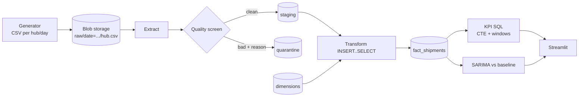

# 📦 ParcelFlow

**A cloud ELT pipeline and parcel-volume forecasting dashboard.** Daily per-hub
shipment files are extracted to blob storage, quality-screened, loaded into a
star-schema warehouse, and forecasted 14 days ahead with SARIMA — all runnable
on a laptop with **one command and zero cloud setup**.

> All data is **synthetic** (generated by this repo). No real FedEx data is used.


---

## What it does

- **Generates** 2 years of realistic daily shipment data for 15 Indian hubs,
  with weekly seasonality, Diwali/festival peaks, monsoon dips — and deliberately
  dirty rows.
- **Extracts** files to blob storage (local filesystem, or Azure Blob / Azurite),
  partitioned by date.
- **Screens** data quality: bad rows are quarantined with a reason, not dropped.
- **Loads** a **star-schema** warehouse (`fact_shipments` + `dim_hub` / `dim_date`
  / `dim_service`).
- **Computes KPIs** in portable SQL using CTEs and window functions.
- **Forecasts** 14-day volume per hub with **SARIMA**, benchmarked against a
  seasonal-naive baseline and scored by **MAPE** on a holdout.
- **Visualises** everything in a Streamlit dashboard.

## Architecture



See [`docs/architecture.md`](docs/architecture.md) for design rationale.

## Tech stack

| Layer | Tech |
|-------|------|
| Language | Python 3.11 |
| Data | pandas, SQLAlchemy Core |
| Warehouse | SQLite (local/CI) · PostgreSQL (Docker/cloud) |
| Blob storage | Local filesystem · Azure Blob / Azurite |
| Forecasting | statsmodels (SARIMA), scikit-learn |
| Dashboard | Streamlit + Plotly |
| Infra | Docker Compose, GitHub Actions |

## Run it in one command (no Docker, no cloud)

```bash
python -m venv .venv && . .venv/Scripts/activate   # Windows
# python3 -m venv .venv && source .venv/bin/activate  # macOS/Linux
pip install -r requirements.txt

python pipeline.py backfill --years 2    # generate + ELT 2 years into SQLite
python pipeline.py forecast              # back-test SARIMA, write metrics.json
streamlit run dashboard/app.py           # open the dashboard
```

That's it — SQLite and a local blob folder are created under `data/`. Use
`python pipeline.py run --date 2024-10-20` for a single idempotent day, or
`python pipeline.py status` to see table counts.

## Run the production-like stack (Docker: Postgres + Azurite)

```bash
docker compose up -d postgres azurite
docker compose run --rm pipeline      # initdb + backfill + forecast
docker compose up dashboard           # http://localhost:8501
```

The **same code** runs here, selected by `DATABASE_URL` and `STORAGE_BACKEND`.

## CLI

| Command | What it does |
|---------|--------------|
| `pipeline.py initdb [--reset]` | create/reset schema + seed dimensions |
| `pipeline.py run --date YYYY-MM-DD` | run one day (idempotent) |
| `pipeline.py backfill --years 2` | run a full date range |
| `pipeline.py forecast [--holdout 14]` | back-test forecasts → `metrics.json` |
| `pipeline.py status` | table counts + recent run log |

## Results (measured from an actual run)

<!-- METRICS:BEGIN -->
_All numbers below come straight from an actual run (the warehouse +
`metrics.json`). Regenerate with `python pipeline.py backfill --years 2 &&
python pipeline.py forecast`._

| Metric | Value |
|--------|-------|
| Hubs | 15 |
| Date range | 2024-11-26 → 2026-11-26 (731 days) |
| Raw files generated (partitioned by date) | 10,965 |
| Rows ingested | 695,104 |
| Shipments in warehouse (`fact_shipments`) | 679,023 |
| Rows quarantined | 16,081 (2.31%) |
| Forecast model | SARIMA(1,0,1)(1,1,1,7) + const |
| Baseline | seasonal-naive (m=7) |
| Avg MAPE — SARIMA | **14.10%** |
| Avg MAPE — baseline | 16.78% |
| SARIMA improvement over baseline | **+15.98%** |
| Automated tests | 21 passing |
| KPI SQL queries (CTEs + window functions) | 7 |
<!-- METRICS:END -->

## Data quality

Each daily file contains a small fraction of deliberately bad rows (nulls,
negative weights, malformed dates, duplicates). The quality stage routes them to
`quarantine_shipments` with a `reason`, and `run_log` records rows in / passed /
quarantined per run — so data loss is always explainable.

## Tests

```bash
pytest -q          # unit + end-to-end (isolated temp SQLite + local storage)
ruff check src tests dashboard
```

## Project layout

```
parcelflow/
  src/parcelflow/
    config.py            env-driven config (DB + storage backend selection)
    storage/             StorageBackend ABC + local & Azure implementations
    db/                  SQLAlchemy engine, star-schema, SQL loader
    generate/            synthetic hubs + shipment generator
    pipeline/            extract · quality · load · dims · transform · runner
    forecast/            SARIMA vs seasonal-naive, MAPE back-test
    cli.py               pipeline CLI
  sql/                   transforms.sql, kpis.sql (CTEs + window functions)
  dashboard/app.py       Streamlit dashboard
  tests/                 pytest suite
  docker-compose.yml     Postgres + Azurite + app
  .github/workflows/     CI + scheduled daily pipeline
```

## Deployment

Not deployed by default. See [`docs/deploy.md`](docs/deploy.md) for free-tier
Streamlit Cloud / Azure steps; paste your live URL here once deployed.

## License

MIT — synthetic data, educational/portfolio project.
