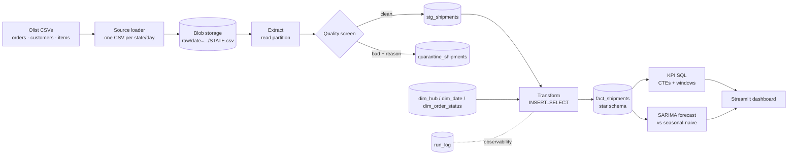

# ParcelFlow — Architecture & Design Decisions

## Overview

ParcelFlow is a batch **ELT pipeline** that turns daily order files into a
dimensional warehouse, plus a **forecasting** layer and a **dashboard**. It runs
identically on a laptop (SQLite + local files) and in a production-like stack
(PostgreSQL + Azure Blob), selected entirely by configuration.

The data is **real**: the [Olist Brazilian e-commerce dataset](https://www.kaggle.com/datasets/olistbr/brazilian-ecommerce)
(~100k orders, 2017–2018). Each order is one row (one parcel shipped to a
customer); orders are grouped to their **destination customer state** (the
"hub") and **purchase date**.

## Why these choices

### Why ELT (not ETL)
Raw files are loaded into the warehouse first and transformed **in SQL** inside
the database. This keeps raw data replayable, lets the database do set-based
work, and mirrors modern cloud-warehouse practice. The transform lives in
`sql/transforms.sql`, not in Python, so it is portable and reviewable.

### Why a star schema
Analytical queries aggregate facts by state, date and order status. A star
schema (`fact_shipments` + conformed dimensions) makes those queries a single
join per dimension, is fast to aggregate, and is the industry-standard
warehouse model. Surrogate integer keys decouple the warehouse from business-key
churn and keep joins cheap.

### Mapping the real data onto the model
The Olist dataset drives every attribute — nothing is invented:

| Model element | Real Olist source |
|---------------|-------------------|
| `dim_hub` (hub) | `customer_state` — the 27 Brazilian federative units |
| `dim_date` | `order_purchase_timestamp` (date part) |
| `dim_order_status` | `order_status` (delivered, shipped, canceled, …) |
| volume (fact count) | one row per order |
| `price`, `freight_value`, `n_items` | summed from `olist_order_items` |
| `delivery_days` | delivered − purchase timestamp |
| `is_delivered` | `order_status = 'delivered'` |
| `is_on_time` | delivered on/before `order_estimated_delivery_date` |

**What was dropped.** The earlier synthetic version had a `dim_service`
(EXPRESS/STANDARD/ECONOMY) and weight/distance/promised-hours measures. Olist
has no equivalent, so they were removed rather than faked — the warehouse models
only what the data actually contains. The India-specific monsoon/festival date
flags were likewise dropped; `dim_date` keeps a generic `is_holiday_season`
(Nov–Dec) flag that matches the real Black-Friday/Christmas spike.

### Why a storage abstraction (Strategy pattern)
`StorageBackend` (`storage/base.py`) has two implementations: local filesystem
and Azure Blob. The pipeline depends only on the interface, so dev/CI run with
zero dependencies while production uses Azure Blob — one config flag,
`STORAGE_BACKEND`, with no change to pipeline code.

### Why SQLAlchemy Core + portable SQL
Defining the schema once (`db/schema.py`) and writing SQL in the
SQLite/Postgres common subset means the **same code is tested on SQLite in CI
and runs on Postgres in Docker/cloud**. On-time is computed as a lexicographic
compare of ISO date strings, which equals a chronological compare on both
engines — no engine-specific date maths in the transform.

### Why idempotent, partition-at-a-time processing
Each date is an independent partition. Stages delete-then-write their
partition, and the source slice for a date is deterministic, so retries,
overlapping schedules and backfills are all safe. This is what makes a daily
cron (or a full-window backfill) robust without a heavyweight orchestrator.

### Why SARIMA, which order, and a seasonal-naive baseline
Daily order volume has strong **weekly seasonality** (weekdays busy, weekends
quiet) and event spikes (Black Friday). The seasonal-naive baseline ("same
weekday last week") is the honesty check — the model must beat it on a 14-day
holdout back-test (MAPE).

**Model selection mattered.** The textbook double-differenced
SARIMA(1,1,1)(1,1,1,7) drifts over a 14-step horizon (double differencing,
`d=1, D=1`, loses the series level). **SARIMA(1,0,1)(1,1,1,7) + constant** — no
regular differencing, one seasonal difference for the weekly cycle, ARMA(1,1)
for short-run autocorrelation — holds the level and beats the baseline. Reported
numbers in the README come straight from `python pipeline.py forecast`.

**Which states are forecast.** São Paulo receives tens of orders a day, but many
states receive under one; their daily series is mostly zeros and a MAPE is
meaningless. The forecaster therefore back-tests only states averaging ≥ 3
orders/day (`forecastable_hubs`). The warehouse still stores **all 27 states**.

### Why Azurite
Azurite emulates Azure Blob locally, so the Azure SDK code path is exercised
with no cloud account or cost. The production topology is reproducible on a
laptop via `docker compose`.

## Trade-offs & what I'd change at scale
- **pandas + SQL** is right for this volume; at larger scale I'd move the
  transform to Spark/Databricks or dbt-on-warehouse (see INTERVIEW_NOTES Q20).
- **Cron via GitHub Actions** is enough to demonstrate scheduled orchestration;
  Airflow/Prefect would add dependency graphs, retries and backfill tooling.
- The source is restricted to the **dense ordering window** (2017-01-01 →
  2018-08-22); the 2016 pilot months and the truncated 2018 tail (order
  collection collapses after 2018-08-22) are excluded so the daily series is a
  regular grid and the forecast holdout lands in complete data.
