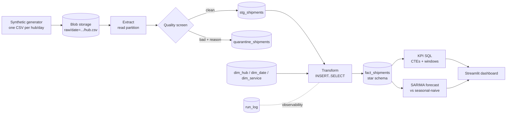

# ParcelFlow — Architecture & Design Decisions

## Overview

ParcelFlow is a batch **ELT pipeline** that turns daily per-hub shipment files
into a dimensional warehouse, plus a **forecasting** layer and a **dashboard**.
It is designed to run identically on a laptop (SQLite + local files) and in a
production-like stack (PostgreSQL + Azure Blob), selected entirely by
configuration.

## Why these choices

### Why ELT (not ETL)
Raw files are loaded into the warehouse first and transformed **in SQL** inside
the database. This keeps raw data replayable, lets the database do set-based
work, and mirrors modern cloud-warehouse practice. The transform lives in
`sql/transforms.sql`, not in Python, so it is portable and reviewable.

### Why a star schema
Analytical queries aggregate facts by hub, date and service. A star schema
(`fact_shipments` + conformed dimensions) makes those queries a single join per
dimension, is fast to aggregate, and is the industry-standard warehouse model.
Surrogate integer keys decouple the warehouse from business-key churn and keep
joins cheap.

### Why a storage abstraction (Strategy pattern)
`StorageBackend` (`storage/base.py`) has two implementations: local filesystem
and Azure Blob. The pipeline depends only on the interface, so dev/CI run with
zero dependencies while production uses Azure Blob — one config flag,
`STORAGE_BACKEND`, with no change to pipeline code. This is the single most
reused design idea in the project.

### Why SQLAlchemy Core + portable SQL
Defining the schema once (`db/schema.py`) and writing SQL in the
SQLite/Postgres common subset means the **same code is tested on SQLite in CI
and runs on Postgres in Docker/cloud**. No ORM models are needed because the
workload is bulk/analytical, not record-by-record CRUD.

### Why idempotent, partition-at-a-time processing
Each date is an independent partition. Stages delete-then-write their
partition, and generation is reproducible, so retries, overlapping schedules
and backfills are all safe. This is what makes a daily cron (or a 2-year
backfill) robust without a heavyweight orchestrator.

### Why SARIMA, which order, and a seasonal-naive baseline
Parcel volume has weekly seasonality, festival/monsoon effects and sub-monthly
demand cycles. The seasonal-naive baseline ("same weekday last week") is the
honesty check — the model must beat it on a 14-day holdout back-test (MAPE).

**Model selection mattered.** The textbook double-differenced
SARIMA(1,1,1)(1,1,1,7) actually *lost* to the baseline (~-8% MAPE) because
double differencing (`d=1, D=1`) makes a 14-step forecast drift away from the
series level. A small validation sweep over orders found
**SARIMA(1,0,1)(1,1,1,7) + constant**: no regular differencing keeps the
forecast anchored, one seasonal difference handles the weekly cycle, and the
ARMA(1,1) terms capture the non-weekly demand cycles. That spec beats the
baseline by **~16% MAPE** (14.1% vs 16.8%). The lesson — always validate a
model against a naive baseline — is itself a talking point.

### Why Azurite
Azurite emulates Azure Blob locally, so the Azure SDK code path is exercised
with no cloud account or cost. The production topology is reproducible on a
laptop via `docker compose`.

## Trade-offs & what I'd change at scale
- **pandas + SQL** is right for this volume; at FedEx scale I'd move the
  transform to Spark/Databricks or dbt-on-warehouse (see INTERVIEW_NOTES Q20).
- **Cron via GitHub Actions** is enough to demonstrate scheduled orchestration;
  Airflow/Prefect would add dependency graphs, retries and backfill tooling.
- **`VOLUME_SCALE`** downscales stored rows so a full 2-year dataset fits a
  laptop while preserving seasonal shape; set it to `1.0` for full scale.
